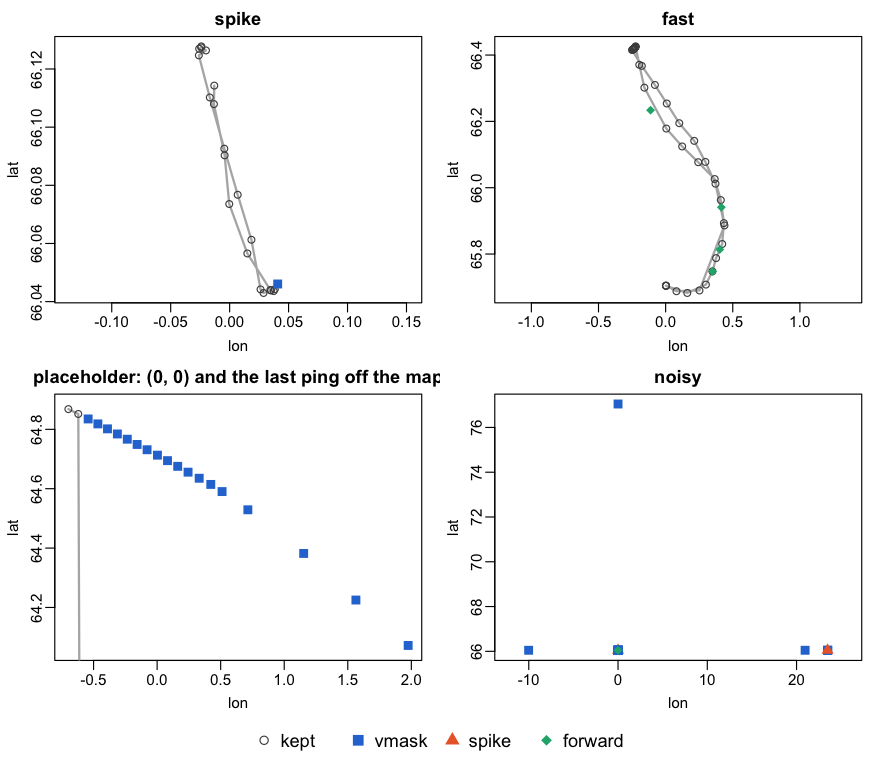

<!-- README.md is generated from README.Rmd. Please edit that file -->

# test: labelling whacky vessel positions

A review copy of `rb_whack_clean()`, the filter the Marine and
Freshwater Research Institute (Iceland) uses for implausible (“whacky”)
positions in vessel tracks. It holds only the filter, so that it can be
read, run and criticised on its own. Comments on the method are more
welcome than comments on the code.

## The method

`rb_whack_clean()` labels; it never drops a row. Every ping gets `whack`
(`TRUE`/`FALSE`) and `whack_stage`, the step that flagged it:

| `whack_stage` | a ping is flagged when | judged from |
|----|----|----|
| `vmask` | the rms speed to the two pings on either side is a local peak above `kn_max`; repeated on the thinned track | both sides |
| `spike` | both legs at the ping are faster than `kn_max` and enclose an angle of 25° or less; repeated | both sides |
| `forward` | the speed from the last *kept* ping is above `kn_max`; the anchor restarts after a gap of more than `max_gap_h` hours | the past only |

`vmask` and `spike` are `argosfilter::sdafilter()` (Freitas et al. 2008)
re-implemented in C++ (`rb_whack_sda()`), with four settings changed for
vessels: 25 knots, a speed test in place of a distance test, every vmask
flag stands, and a time-step floor in place of argosfilter’s 1 s added
to every step. The forward scan (`rb_whack_forward()`) runs on what they
leave. On 543.6 million Icelandic AIS pings (2007–2026) it flags 0.27 %.

Every speed, in all three stages, uses a time step of at least
`min_dt_s` = 10 s: over a few seconds the error in position and the
whole-second timestamps dominate a speed. The price is that within 10 s
a jump is seen only if it is more than 130 m (`kn_max × min_dt_s`). On
two months of Icelandic AIS (7.2 million pings) a floor of 10 s kept no
leg longer than 200 m at over 25 knots; 20 s kept 575 and 60 s kept
6,881. On the whole record, 10 s in place of a 1-microsecond floor
halves the flags, almost all of them near-duplicate reports from two
merged feeds, and leaves the length of the kept track unchanged.

## Merged feeds: near-duplicates first

When tracks from two feeds are merged (say a national receiver network
and a commercial terrestrial or satellite feed), a vessel heard by both
is reported twice: the same fix, a second or two apart and centimetres
to metres apart. Such a pair is not whacky, and it is not an exact
duplicate either: neither a match on `(vid, time)` nor on whole rows
removes it. A short time-step floor used to remove one copy by accident,
as an “impossible” speed; with the 10 s floor `rb_whack_clean()`
correctly leaves the pair alone. So the copies are taken out first, by
what they are:

`rb_whack_duplicates()` flags a ping when a feed ranked higher in
`priority` has a ping of the same `vid` within `max_dt_s` = 10 s and
within what `kn_max` allows in that time (128.6 m), among the three
nearest pings on each side. The top feed is never flagged; two pings of
one feed are left alone. In the Icelandic record (four feeds, 2013–2026)
it flags 1.2 % of pings, with a median gap of 1–4 s and a median
distance of 0.1–0.4 m by feed pair.

The four examples below come from one feed and carry no feed column, so
this is shown on a constructed case: one stk fix, its astd copy 2 s and
0.2 m later, and an astd fix a minute on.

``` r
library(test)
t0 <- as.POSIXct("2000-01-01 00:00:00", tz = "UTC")
rb_whack_duplicates(vid  = c(1, 1, 1),
                    time = t0 + c(0, 2, 60),
                    lon  = c(-22, -22.000004, -22.01),
                    lat  = c(64, 64, 64),
                    feed = c("stk", "astd", "astd"))
#> [1] FALSE  TRUE FALSE
```

In a pipeline:
`mutate(dup = rb_whack_duplicates(vid, time, lon, lat, provider))`, keep
`filter(!dup)`, then `rb_whack_clean()`.

## Install

The filter is C++, so a compiler is needed first: Rtools on Windows,
`xcode-select --install` on macOS, `r-base-dev` on Linux. Then, from the
tarball (or the unpacked folder) you received:

``` r
install.packages(c("remotes", "duckdbfs"))
remotes::install_local("test_0.1.0.tar.gz")
```

The package itself needs only dplyr and Rcpp; duckdbfs reads the example
file below and runs the DuckDB path.

## Four examples

Four short tracks from the Icelandic AIS data, chosen to show a typical
case and three hard ones. They are anonymised: the vessel id is replaced
by 1–4, each track starts on 2000-01-01 00:00 UTC, and the longitudes
are shifted by a constant per track. Neither shift changes a time step,
a distance or an angle, so the labels are those of the original data
(checked).

The input is one row per ping with `vid`, `time` (POSIXct), `lon` and
`lat`; other columns are carried along.

``` r
library(test)
library(dplyr, warn.conflicts = FALSE)

f <- system.file("extdata", "whacky_examples.parquet", package = "test")
pings <- duckdbfs::open_dataset(f) |> collect()

d <- rb_whack_clean(pings)
d |> count(example, whack_stage)
#> # A tibble: 10 × 3
#>    example     whack_stage     n
#>    <chr>       <chr>       <int>
#>  1 fast        forward         4
#>  2 fast        <NA>           43
#>  3 noisy       forward         1
#>  4 noisy       spike           2
#>  5 noisy       vmask          20
#>  6 noisy       <NA>            1
#>  7 placeholder vmask          18
#>  8 placeholder <NA>            4
#>  9 spike       vmask           1
#> 10 spike       <NA>           20
```

<!-- -->

**spike** – the common case. A position every few minutes, and one ping
that is reached at 26 knots and left at 113. vmask flags it, nothing
else.

**fast** – a vessel steaming at 24–25 knots. The forward scan flags four
real pings, each reached at just over 25 knots. `kn_max` has to sit
above the top speed of the fleet:

``` r
pings |> filter(example == "fast") |> rb_whack_clean(kn_max = 26) |> count(whack_stage)
#> # A tibble: 1 × 2
#>   whack_stage     n
#>   <chr>       <int>
#> 1 <NA>           47
```

**placeholder** – a smooth track at 13–15 knots, then a (0, 0) ping
written by the logger, then one ping 13 days later. The (0, 0) ping is
second to last, where vmask cannot judge it (it needs two pings on
either side), so vmask flags the good pings before it one by one. That
leaves a gap of almost seven hours, the forward scan restarts there, and
the placeholder is kept. Placeholders are not positions and should go
before the filter:

``` r
pings |> filter(example == "placeholder", !(lon == 0 & lat == 0)) |> rb_whack_clean() |> count(whack_stage)
#> # A tibble: 1 × 2
#>   whack_stage     n
#>   <chr>       <int>
#> 1 <NA>           21
```

**noisy** – a vessel lying still while its logger alternates between the
true position and a position with one coordinate wrong. The first ping
is a wrong one: it has no predecessor, so the two-sided tests cannot
judge it and the forward scan takes it as its anchor. 23 of 24 pings are
flagged, and the one kept is wrong. When bad pings are as frequent as
good ones, the filter sees that neighbours disagree, not which of them
is right.

## DuckDB

On a lazy DuckDB table (e.g. a parquet dataset opened with duckdbfs) the
result stays lazy: whole vessels are labelled in batches and only the
flagged rows go back to DuckDB, so a large dataset never has to fit in
R. The labels are the same as on a data frame.

``` r
duckdbfs::open_dataset(f) |> rb_whack_clean() |> count(example, whack_stage) |> collect() |>
  arrange(example, whack_stage)
#> # A tibble: 10 × 3
#>    example     whack_stage     n
#>    <chr>       <chr>       <dbl>
#>  1 fast        forward         4
#>  2 fast        <NA>           43
#>  3 noisy       forward         1
#>  4 noisy       spike           2
#>  5 noisy       vmask          20
#>  6 noisy       <NA>            1
#>  7 placeholder vmask          18
#>  8 placeholder <NA>            4
#>  9 spike       vmask           1
#> 10 spike       <NA>           20
```

## Open questions for the review

- One `kn_max` for all vessels: fast vessels lose real track, while slow
  gears could hide errors below it.
- The time-step floor `min_dt_s` = 10 s: chosen on Icelandic AIS, where
  steps under 10 s are about 1 % and come mostly from two feeds merged.
  Is it right for denser or sparser data?
- The ends of a track: the first and last two pings cannot be judged
  from both sides.
- Should placeholder positions ((0, 0), `lon == lat`) be removed inside
  the filter rather than before it?
- Near-duplicates: is 10 s and 128.6 m the right window, and should the
  copy be dropped or the two reports merged into one?
- Interleaved streams, two transmitters reporting under one id: the
  filter drops most of such a burst.

## AI use

This package was assembled, the examples extracted and anonymised, and
this README drafted by Claude (Anthropic) at the author’s request. The
method is the author’s.

## Reference

Freitas, C., Lydersen, C., Fedak, M.A. and Kovacs, K.M. (2008). A simple
new algorithm to filter marine mammal Argos locations. *Marine Mammal
Science* 24:315–325.
